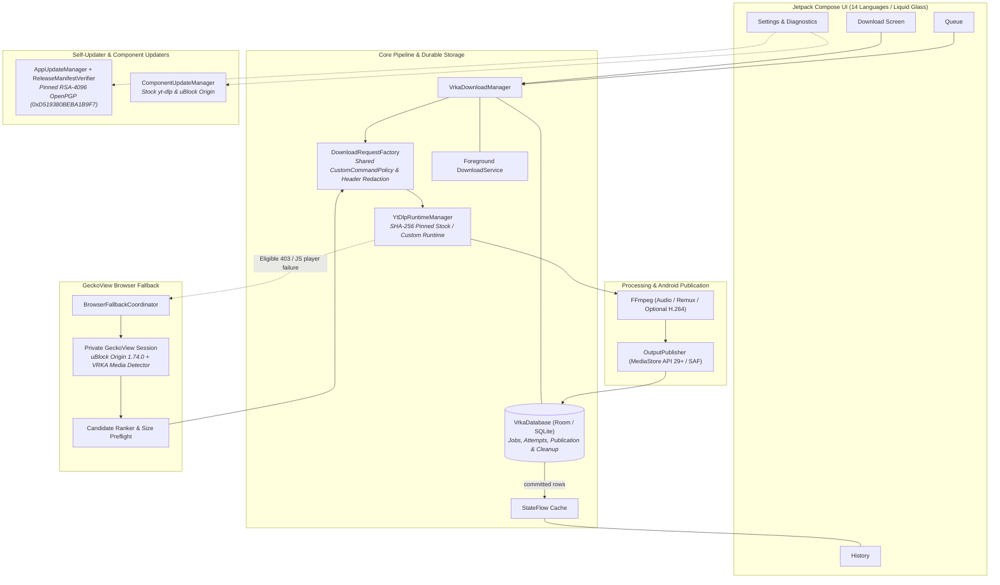

<div align="center">
  
  <h1>VRKA Android</h1>
  <p><b>Native on-device Android media downloader &amp; passive web stream discovery</b></p>
  <p>
    <a href="https://github.com/MaverickRox/VRKA-Android/releases/latest"><b>Latest Published APK (v5.1.5)</b></a> •
    <a href="docs/README.md"><b>Documentation Hub</b></a> •
    <a href="docs/user-guide/GETTING_STARTED.md"><b>Getting Started</b></a> •
    <a href="CHANGELOG.md"><b>Changelog</b></a> •
    <a href="SECURITY.md"><b>Security Policy</b></a> •
    <a href="LICENSE"><b>GPL-3.0</b></a>
  </p>
  <p>
    
    
    
    
    
  </p>
</div>

> [!IMPORTANT]
> **VRKA v5.1.5 (`versionCode 50105`) Official Release & Upgrade Guide:**
> - **Current Release (`v5.1.5`):** Introduces playlist child-job expansion, composite playlist selection dialogs, hardened MediaStore publication and recovery, modern transparent header wordmark, offline extension cryptographic verification, and Android 16 download notifications.
> - **Upgrading Official Published Installs (from `v5.1.4`, `v5.1.3`, or `v5.1.2`):** Update directly through **Settings -> Check for Updates** or install `VRKA-Android-v5.1.5.apk` over your existing install without uninstalling. Existing Queue, History, Settings, and custom templates are preserved intact.
> - **From v5.0.2 or older:** Due to a historical staging filename bug in the old v5.0.2 client, its in-app updater cannot self-execute this upgrade. First install [`VRKA-Android-v5.1.2.apk`](https://github.com/MaverickRox/VRKA-Android/releases/tag/v5.1.2) manually over v5.0.2 **without uninstalling**, open the app once, then update normally to `v5.1.5` or newer.
> - **Prior Releases:** See [CHANGELOG.md](CHANGELOG.md) or [GitHub Releases](https://github.com/MaverickRox/VRKA-Android/releases) for historical release notes. Prior stable release: [`v5.1.4`](https://github.com/MaverickRox/VRKA-Android/releases/tag/v5.1.4).

---

## Overview

**VRKA Android** is a full-featured mobile version of desktop [**VRKA**](https://github.com/MaverickRox/VRKA), built natively in Jetpack Compose. All media extraction, remuxing, and optional transcoding happen directly on your phone using bundled `yt-dlp`, `FFmpeg`, and an embedded Mozilla `GeckoView` private fallback browser.

VRKA includes no application analytics, advertising, or crash-reporting SDKs, and does not upload History, queue state, or diagnostics to an application backend. Network requests are strictly limited to documented GitHub release/component checks, user-requested downloads, and user-initiated Browser Fallback pages; see [docs/PRIVACY_NETWORK.md](docs/PRIVACY_NETWORK.md).

### Why VRKA

- **Unified On-Device Engine:** Direct extraction with `yt-dlp` plus local `FFmpeg` muxing, MP3 (`128`–`320 kbps`), Opus, WAV, subtitle embedding, trimming, playlist ranges, and optional H.264 Compatibility Mode.
- **Resolution-Aware Size Estimation:** Pre-download confirmation uses the exact `-f` format selector and 60 FPS sort executed by the transfer; unavailable sizes are shown honestly instead of invented.
- **Browser Fallback When Sites Block Direct Requests:** Launches a task-scoped private `GeckoView` session with bundled `uBlock Origin` (`1.74.0`) and the first-party `VRKA Media Detector` WebExtension, handing chosen streams back to `yt-dlp`.
- **Crash-Safe Room Storage:** Single SQLite/Room (`VrkaDatabase`) authority for Queue, History, retry attempts, publication transactions, and cleanup obligations.
- **Hardened Self-Updater & Supply Chain:** OpenPGP-signed release manifests verified against a pinned RSA-4096 trust anchor (`0xD519380BEBA1B9F7`), anti-rollback revision checks, expiration enforcement, and APK SHA-256 + version-code + certificate verification.
- **14 Languages + AMOLED Liquid Glass UI:** Localized across 14 languages (including full RTL layout for Arabic) with hardware-accelerated backdrop blur and AGSL shader refraction on API 33+.

---

## Documentation Hub

| Audience | Recommended Starting Points |
|---|---|
| **Users** | [Getting Started](docs/user-guide/GETTING_STARTED.md) • [Features & Settings](docs/user-guide/FEATURES_AND_SETTINGS.md) • [Troubleshooting](docs/user-guide/TROUBLESHOOTING.md) |
| **Developers** | [Documentation Index](docs/README.md) • [Build & Test Guide](docs/developer/BUILD_AND_TEST.md) • [Production Architecture](CURRENT_PRODUCTION_ARCHITECTURE.md) • [Storage Architecture](docs/STORAGE_ARCHITECTURE.md) |
| **Security & Auditors** | [Security Policy](SECURITY.md) • [Security Review](SECURITY_REVIEW.md) • [Updater & Runtime Security Model](docs/security/UPDATER_AND_CUSTOM_RUNTIME_MODEL.md) • [Privacy & Network](docs/PRIVACY_NETWORK.md) |
| **Supply Chain & Release** | [Release Notes](RELEASE_NOTES.md) • [Release Provenance](docs/RELEASE_PROVENANCE.md) • [Release Evidence](RELEASE_EVIDENCE.md) • [Dependency Management](docs/DEPENDENCY_MANAGEMENT.md) • [CI/CD Security](docs/CI_CD_SECURITY.md) |

---

## Key Features in Detail

### Media Pipeline & Controls
- **Formats & Options:** Video (`Best`, `2160p`, `1440p`, `1080p`, `720p`, `480p`, `360p`), `Prefer 60 FPS`, Audio (`MP3` `128–320 kbps`, `Opus`, `WAV`), trim sections, subtitles, and bounded playlist ranges.
- **H.264 Compatibility Mode:** Optional local `libx264` conversion for broader hardware/app compatibility (off by default).
- **Custom Headers & Diagnostics:** RFC 7230-validated headers with CRLF rejection; sensitive credentials redacted (`[REDACTED]`). Failed jobs retain sanitized local failure context only (never uploaded automatically); explicit opt-in warns before exporting unredacted failure URLs.
- **Custom Command Templates:** Safe `argv` template builder blocking shell execution (`--exec*`, `--downloader*`), output/path overrides (`-o`, `-P`), insecure TLS flags, and persistent credential headers (`Cookie`, `Authorization`), re-validated cleanly at request build time via shared `CustomCommandPolicy` helpers.
- **Custom `yt-dlp` Runtimes:** Stock bundled `yt-dlp` (`app/src/main/res/raw/ytdlp`) uses OpenPGP component verification (`SecureComponentUpdater`). Optional third-party GitHub `owner/repo` zipapp runtimes require explicit untrusted-runtime warning confirmation displaying the repo, version, and SHA-256, CPython `--version` execution in staging, and continuous on-disk SHA-256 re-verification with fail-closed fallback to stock.

### Supported Languages (14 + System Default)
Arabic (`ar`, full RTL), Bengali (`bn`), Simplified Chinese (`zh-rCN`), English (`en`), French (`fr`), German (`de`), Gujarati (`gu`), Hindi (`hi`), Kannada (`kn`), Portuguese Brazil (`pt-rBR`), Portuguese Portugal (`pt-rPT`), Spanish (`es`), Tamil (`ta`), and Telugu (`te`). See [docs/developer/BUILD_AND_TEST.md](docs/developer/BUILD_AND_TEST.md) and [CURRENT_PRODUCTION_ARCHITECTURE.md](CURRENT_PRODUCTION_ARCHITECTURE.md) for localization parity guarantees.

---

## Architecture



See [CURRENT_PRODUCTION_ARCHITECTURE.md](CURRENT_PRODUCTION_ARCHITECTURE.md), [docs/STORAGE_ARCHITECTURE.md](docs/STORAGE_ARCHITECTURE.md), and [docs/security/UPDATER_AND_CUSTOM_RUNTIME_MODEL.md](docs/security/UPDATER_AND_CUSTOM_RUNTIME_MODEL.md) for full details.

---

## Building & Verifying Locally

See [docs/developer/BUILD_AND_TEST.md](docs/developer/BUILD_AND_TEST.md) for complete setup and API 36 emulator test commands. Quick summary:

```powershell
# Full CI-equivalent offline/strict verification on Windows (set JAVA_HOME / ANDROID_HOME first)
.\gradlew.bat --no-daemon --no-configuration-cache --dependency-verification=strict `
  testDebugUnitTest lintDebug lintRelease compileDebugAndroidTestKotlin compileReleaseKotlin `
  assembleDebug assembleDebugAndroidTest assembleDevRelease
```

Production release signing is strictly isolated (`assembleRelease` fails closed without external `signing.properties` / `VRKA_SIGNING_PROPERTIES`; debug/CI builds never read production credentials). Supply-chain controls (repository allowlisting, no `mavenLocal()`, lockfiles, SHA-256 dependency verification metadata, SHA-pinned GitHub Actions, and native asset inventory) are documented in [docs/DEPENDENCY_MANAGEMENT.md](docs/DEPENDENCY_MANAGEMENT.md) and [docs/CI_CD_SECURITY.md](docs/CI_CD_SECURITY.md).

---

## Origin, Attribution & License

- **Mobile Edition:** Full-featured Android version of desktop [**VRKA**](https://github.com/MaverickRox/VRKA) by [MaverickRox](https://github.com/MaverickRox).
- **Third-Party Software & Demo Assets:** Uses `yt-dlp` (Unlicense), Mozilla `GeckoView` (MPL-2.0), `uBlock Origin` (GPL-3.0), `FFmpeg` (GPL-3.0-or-later), `Space Mono` (OFL-1.1), `Mornye` switch component (LGPL-3.0 / GPL-3.0), Blender Foundation Creative Commons Open Movies (*Big Buck Bunny*, *Sintel*, *Tears of Steel*, CC-BY 3.0), and Google *Shaka Player* demo (Apache-2.0). Full attribution is in [THIRD_PARTY_NOTICES.md](THIRD_PARTY_NOTICES.md).
- **License:** Free software under [GNU General Public License v3.0](LICENSE).
