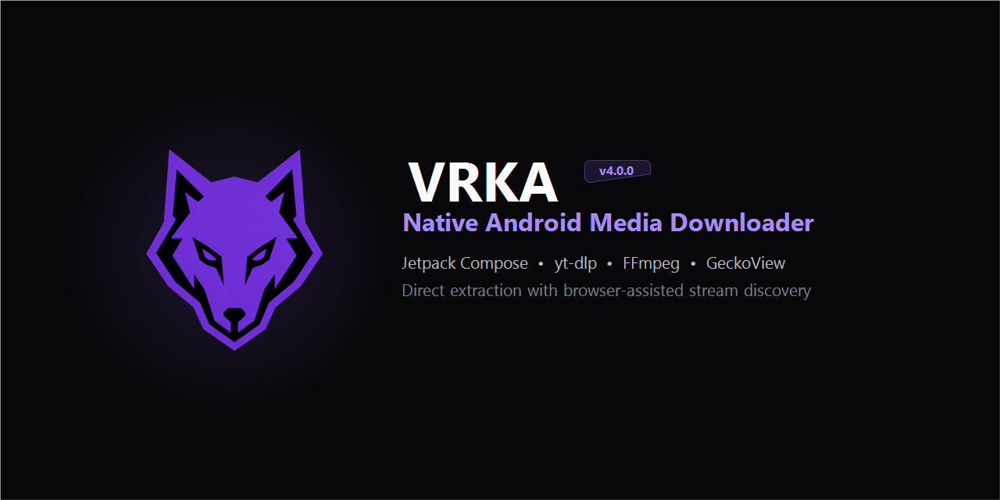
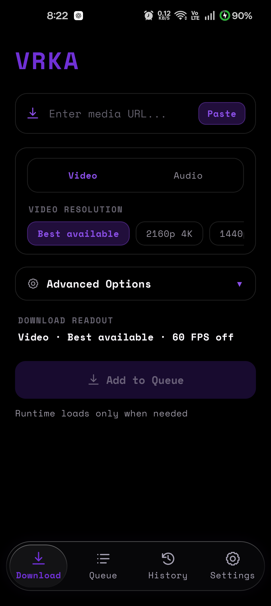
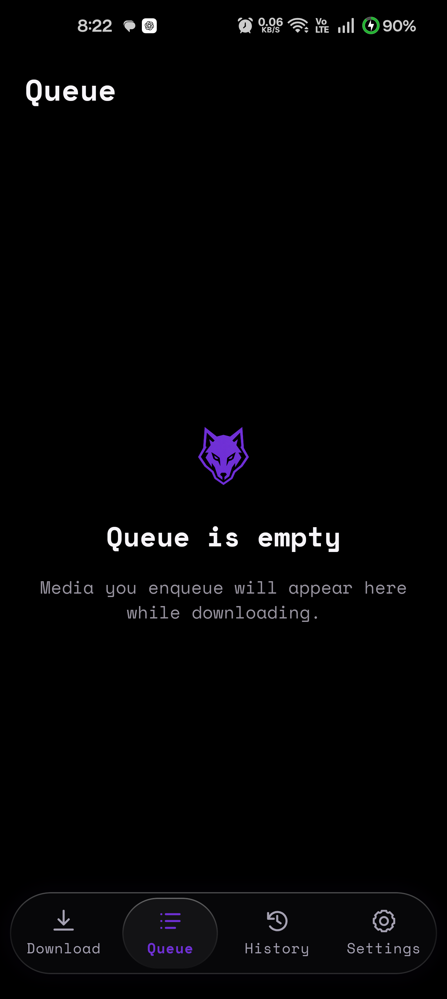
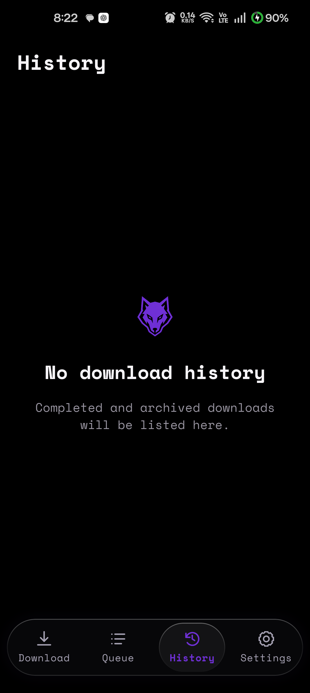
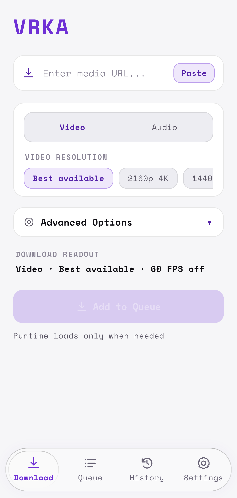

<div align="center">
  
  <h1>VRKA Android</h1>
  <p><strong>Native Android media downloader and passive web stream discovery.</strong></p>

  <p>
    <a href="https://github.com/MaverickRox/VRKA-Android/releases/latest"></a>
    <a href="LICENSE"></a>
    <a href="https://github.com/MaverickRox/VRKA-Android/releases"></a>
  </p>

  <p>
    <a href="https://github.com/MaverickRox/VRKA-Android/releases/latest"><b>Download APK (v5.1.0)</b></a> •
    <a href="#screenshots">Screenshots</a> •
    <a href="#architecture">Architecture</a> •
    <a href="#build-instructions">Build Guide</a> •
    <a href="#release-signing">Signing Protocol</a> •
    <a href="SECURITY.md">Security</a>
  </p>
</div>

<br />

> [!IMPORTANT]
> **USERS UPGRADING FROM VRKA v5.0.2 MUST DOWNLOAD AND INSTALL v5.1.0 DIRECTLY FROM THE OFFICIAL GITHUB RELEASE PAGE. THE v5.0.2 IN-APP UPDATER CANNOT COMPLETE THIS UPDATE. DO NOT USE THE RETRY BUTTON.**
> 
> **OFFICIAL DOWNLOAD PAGE:**
> https://github.com/MaverickRox/VRKA-Android/releases/tag/v5.1.0
> 
> **INSTALLATION:** Download `VRKA-Android-v5.1.0.apk` from the Assets section and install it over your existing VRKA installation. DO NOT UNINSTALL v5.0.2 FIRST.

<div align="center">
  
</div>

---

## Origin

> [!NOTE]
> VRKA Android is the Android companion of the desktop media downloader [**VRKA**](https://github.com/MaverickRox/VRKA) by [MaverickRox](https://github.com/MaverickRox).
>
> - **Desktop Source Repository**: [https://github.com/MaverickRox/VRKA](https://github.com/MaverickRox/VRKA)
> - **Android Port Repository**: [https://github.com/MaverickRox/VRKA-Android](https://github.com/MaverickRox/VRKA-Android)

---

## Overview

**VRKA Android** is built with **Jetpack Compose** and **Kotlin Coroutines**. Normal downloads and Browser Fallback transfers use `yt-dlp`; GeckoView provides browser navigation and media discovery, while FFmpeg handles local post-processing and validation. uBlock Origin is used as a browser privacy filter.

Designed for local, on-device processing without an application analytics service, featuring an AMOLED-optimized Liquid Glass interface.

---

## Screenshots

<div align="center">
<table>
  <tr>
    <td align="center" width="33%">
      <br />
      <b>Download Interface</b><br />
      <sub>Format, resolution & codec selection</sub>
    </td>
    <td align="center" width="33%">
      <br />
      <b>Task Queue</b><br />
      <sub>Persistent queue with optional concurrency</sub>
    </td>
    <td align="center" width="33%">
      <br />
      <b>Download History</b><br />
      <sub>Archived tasks & media files</sub>
    </td>
  </tr>
  <tr>
    <td align="center" width="33%">
      <br />
      <b>Light Mode</b><br />
      <sub>Adaptive high-contrast light theme</sub>
    </td>
  </tr>
</table>
</div>

---

## Features

- **Direct Extraction & Download**: Powered by `yt-dlp` and `FFmpeg` (`arm64-v8a`), supporting video/audio stream extraction where provided by the source, resolution selection (Best, 4K, 1440p, 1080p, 720p, etc.), 60 FPS preference, subtitle embedding, and audio extraction (MP3 with 128–320 kbps selectable bitrate, Opus with prefer native stream-copy remuxing and fallback transcode, and uncompressed 16-bit PCM WAV).
- **Subtitle Scope**: Subtitle download and embedding options apply to normal yt-dlp jobs. Browser Fallback does not currently fetch subtitles.
- **Custom HTTP Headers & Injection Protection**: Network customization with dedicated `Referer` and `Origin` parameters and user-defined HTTP headers validated against RFC 7230 token specifications and CRLF injection rejection.
- **Sensitive Header Redaction**: Multi-tier data protection masking sensitive authorization tokens, cookies, and secret headers (`[REDACTED]`) across logs, crash diagnostics, on-device stores, and UI cards.
- **Dynamic Font Preference**: User-toggleable application typography supporting the signature monospace `VRKA Font` (Space Mono) and clean `System Font` (Roboto / device default) with persistent DataStore configuration.
- **Download Location Modes**: Clear destination control supporting "Use selected" (defaulting to Downloads/VRKA with persistent directory permissions) or "Ask every time" (modal confirmation before queuing).
- **Background Orchestration**: Foreground `DownloadService` with `JobStore` persistence, notification progress tracking, cancellation, and optional persisted parallel job execution (2–4 workers; sequential by default).
- **Passive Browser Fallback**: An embedded Mozilla `GeckoView` session automatically activates when direct extraction encounters anti-bot challenges or client-side player scripts.
- **Integrated Content Filtering**: Bundled `uBlock Origin` WebExtension filters network requests to suppress intrusive ads and tracking scripts during fallback stream observation.
- **Browser Fallback Discovery**: The VRKA media-detector WebExtension observes browser requests and page media elements, including direct media, HLS and DASH candidates. Candidate discovery is followed by yt-dlp probing and the standard yt-dlp transfer.
- **Local On-Device Diagnostics**: On-device diagnostic failure logging in Settings with stage attribution, terminal trace viewer, secret-sanitized reporting, and one-tap clipboard export.
- **In-App Component Updates**: The app checks and updates the active yt-dlp and uBlock Origin components. Installed versions come from the running yt-dlp runtime or the installed/bundled extension; “Up to date” is shown only after a successful remote check.
- **In-App Application Self-Update**: Secure in-app update checker querying GitHub Releases with a 24-hour automatic gate, manual checks from Settings, strict stable three-part semantic versions, exact APK asset verification (`VRKA-Android-vX.Y.Z.apk`), HTTPS redirect validation, and package/version/code/signing-certificate verification before FileProvider installation.
- **Browser Session Clearing**: Settings clears GeckoView cookies, DOM storage, auth sessions, site data, caches and in-memory discovered candidates. It does not cancel an active fallback.
- **H.264 Compatibility Mode**: Optional, off by default. If a downloaded video is not H.264, FFmpeg converts the local staged file, validates the result and preserves supported audio/subtitle streams.
- **Custom yt-dlp Commands**: Named argument templates for normal jobs. Templates are argv lists, not shell commands; VRKA controls output staging. Eligible failures can still enter Browser Fallback, whose standard yt-dlp request ignores the selected template.
- **Liquid Glass Design System**: Floating capsule navigation with hardware-accelerated `RenderEffect` backdrop blur across AMOLED Black and Light modes.

### In-App Application Self-Update

VRKA Android includes a hardened, cryptographically verified in-app update engine querying official GitHub releases:

- **OpenPGP Authenticated Release Manifests**: Every release publishes a machine-readable manifest (`VRKA-Android-vX.Y.Z.manifest.json`) authenticated by a detached OpenPGP signature (`VRKA-Android-vX.Y.Z.manifest.json.asc`).
- **Pinned OpenPGP Trust Anchor**: Updates are cryptographically verified against the pinned official 4096-bit RSA release signing key (`0xD519380BEBA1B9F7`, fingerprint `71165A658B3A8612AC2568C6D519380BEBA1B9F7`) embedded within the application.
- **Anti-Rollback & Anti-Freeze Protections**: Monotonically non-decreasing metadata revision numbers prevent replay attacks, while mandatory expiration timestamps prevent freeze attacks.
- **24-Hour Automatic Gate**: Automatic startup checks run at most once every 24 hours to reduce network traffic.
- **Manual Check Bypass**: The `[Check for Updates]` button in Settings bypasses the 24-hour interval to check immediately.
- **Non-Blocking Startup**: Checks run asynchronously without slowing down app startup.
- **Canonical Stable Releases**: Accepts stable three-part tags such as `v5.1.0`, compares numeric version segments, and requires the exact matching asset `VRKA-Android-v5.1.0.apk`.
- **HTTPS-Only Networking & Host Validation**: Streams metadata and APK files over HTTPS from approved GitHub release hosts, rejecting user-info, nonstandard ports, and unapproved hosts.
- **Redirect Validation**: Validates every redirect target and limits redirect hops to at most 5.
- **Two-Stage Install Verification**: Verifies archive integrity, package identity, version code, and signer certificate on temporary downloads, followed by canonical filename verification on staged files before launching Android's `PackageInstaller`.
- **Persistent Downloads**: Downloads run through WorkManager so they survive process death or backgrounding.

### In-App Component Updates

VRKA Android independently manages and updates its core media and filtering components:

- **yt-dlp**: The installed runtime version is queried when available and updated using the app's updater. No historical version is presented as the active version when it cannot be queried.
- **uBlock Origin**: Bundled as a Firefox XPI (`uBlock0@raymondhill.net`) in `assets/extensions/ublock.xpi`; it is installed and enabled for Browser Fallback sessions. The Settings version row reports the detected runtime/package/update version rather than an embedded historical label.
- **Persistent Background Execution**: Component updates use WorkManager to survive Activity recreation and backgrounding.
- **Concurrency & Spam Protection**: Only one update operation runs per component at a time. Rapid button taps are de-duplicated without freezing the UI.

---

## Architecture

```
┌────────────────────────────────────────────────────────┐
│                   Jetpack Compose UI                   │
│   (HomeScreen, JobsScreen, HistoryScreen, Settings)   │
└──────────────────────────┬─────────────────────────────┘
                           │
┌───────────────────┐
│ Compose UI / Queue│
└─────────┬─────────┘
          ▼
┌──────────────────────┐     ┌─────────────────────────────┐
│ VrkaDownloadManager  │────▶│ yt-dlp normal acquisition   │
└──────────┬───────────┘     └──────────────┬──────────────┘
           │ eligible failure                │
           ▼                                 │
┌────────────────────────────┐               │
│ GeckoView + detector bridge│               │
│ candidate store / ranker   │               │
└──────────────┬─────────────┘               │
               └──── selected candidate ────┘
                              ▼
                 ┌────────────────────────┐
                 │ FFmpeg local processing│
                 │ validation / publish   │
                 └────────────────────────┘
```

### Architectural Highlights

1. **UI Layer**: Built with Jetpack Compose and design tokens (`VrkaTokens`), featuring floating capsule navigation with adaptive backdrop blur across AMOLED Dark and Light modes.
2. **Download Pipeline**: `VrkaDownloadManager` invokes yt-dlp through the ordinary request factory. An eligible failure can enter Browser Fallback. A failed custom-template attempt follows the same eligibility check.
3. **Browser Fallback**: GeckoView navigates in a task-scoped private session. The media-detector WebExtension and GeckoMediaBridge feed the candidate store/ranker. yt-dlp probes the selected candidate and performs the transfer using its standard request path; custom template arguments and custom request headers are not carried into that handoff. FFmpeg is used only for local processing and validation.
4. **Components and Updates**: yt-dlp and uBlock Origin are the active update-managed components. GeckoView's dependency version is declared once in the Gradle build and displayed from generated BuildConfig.

---

## Requirements

- **Device Architecture**: `arm64-v8a`
- **Minimum OS**: Android 8.0 (API Level 26)
- **Target OS**: Android 16 (API Level 36)
- **Java Development Kit**: JDK 17 or newer supported by the configured Gradle version (Android Studio JBR is suitable)
- **Android SDK**: Build-Tools 36.1+

---

## Build Instructions

### Prerequisites

Set `JAVA_HOME` to your JDK 17+ path:
```powershell
$env:JAVA_HOME = "C:\Program Files\Android\Android Studio\jbr"
```

### Running Offline Unit Tests

```powershell
.\gradlew.bat testDebugUnitTest --offline
```

### Assembling Debug APK

```powershell
.\gradlew.bat assembleDebug --offline
```
Output artifact: `app/build/outputs/apk/debug/app-debug.apk`

### Assembling Release APK

Production release builds require explicit signing credentials. The build system **strictly rejects release builds without credentials** and will never silently fall back to debug signing.

1. Configure your release signing properties (outside Git) in `~/.vrka-android-signing/signing.properties` or via the `VRKA_SIGNING_PROPERTIES` environment variable:

```properties
storeFile=/absolute/path/to/vrka-release.p12
storePassword=YOUR_KEYSTORE_PASSWORD
keyAlias=YOUR_KEY_ALIAS
keyPassword=YOUR_KEY_PASSWORD
```

2. Build the release APK:

```powershell
$env:VRKA_SIGNING_PROPERTIES = "C:\Users\username\.vrka-android-signing\signing.properties"
.\gradlew.bat assembleRelease --offline
```

The compiled release artifact will be located at:
```
app/build/outputs/apk/release/app-release.apk
```

The official v5.1.0 release APK is production-signed. Check [RELEASE_EVIDENCE.md](RELEASE_EVIDENCE.md) for its exact path, SHA-256, package metadata and signing certificate.

---

## Release Signing

The `release` build type requires explicit signing credentials and never silently falls back to a debug key. Verify the v5.1.0 artifact's certificate and SHA-256 against [RELEASE_EVIDENCE.md](RELEASE_EVIDENCE.md) or official release checksums before installation.

---

## Installation

> [!NOTE]
> **Upgrading from v5.0.2**: Due to a known client-side verification check on temporary download files in the v5.0.2 binary, the in-app updater cannot self-execute the upgrade. Existing v5.0.2 users should download `VRKA-Android-v5.1.0.apk` directly and install it over v5.0.2. Because both versions share the identical production signing key, all app data, settings, and download histories are preserved.

1. Download the official `VRKA-Android-v5.1.0.apk` from [GitHub Releases](https://github.com/MaverickRox/VRKA-Android/releases/latest).
2. Verify the SHA-256 hash against `SHA256SUMS`:
   ```powershell
   (Get-FileHash .\VRKA-Android-v5.1.0.apk -Algorithm SHA256).Hash
   ```
   Expected: `CA5C74F0C59A98FE225D133A79E98A9E2913E8F82BFDAC0C841A27F2DCD1F28A`. The same value is recorded in `SHA256SUMS` and the official release page.
3. Install on your Android device:
   ```bash
   adb install -r .\VRKA-Android-v5.1.0.apk
   ```

---

## Third-Party Notices & Attribution

VRKA Android integrates the following open-source software:
- **yt-dlp**: The Unlicense ([yt-dlp/yt-dlp](https://github.com/yt-dlp/yt-dlp))
- **Mozilla GeckoView**: Mozilla Public License 2.0 ([GeckoView](https://wiki.mozilla.org/Mobile/GeckoView))
- **uBlock Origin**: GNU General Public License v3.0 ([gorhill/uBlock](https://github.com/gorhill/uBlock))
- **FFmpeg**: LGPL / GPL licensed components
- **Space Mono Font**: SIL Open Font License 1.1

---

## License

VRKA Android is free software licensed under the [GNU General Public License v3.0](LICENSE).
See the [LICENSE](LICENSE) file for details.
