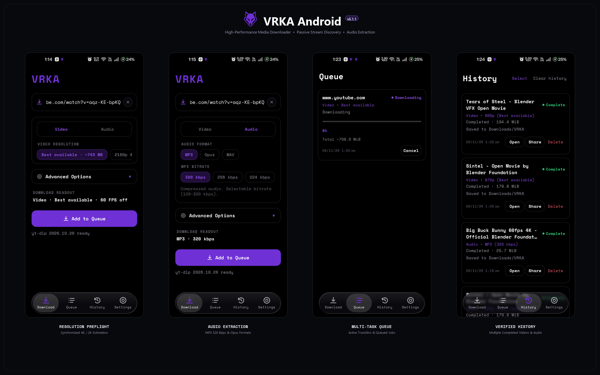
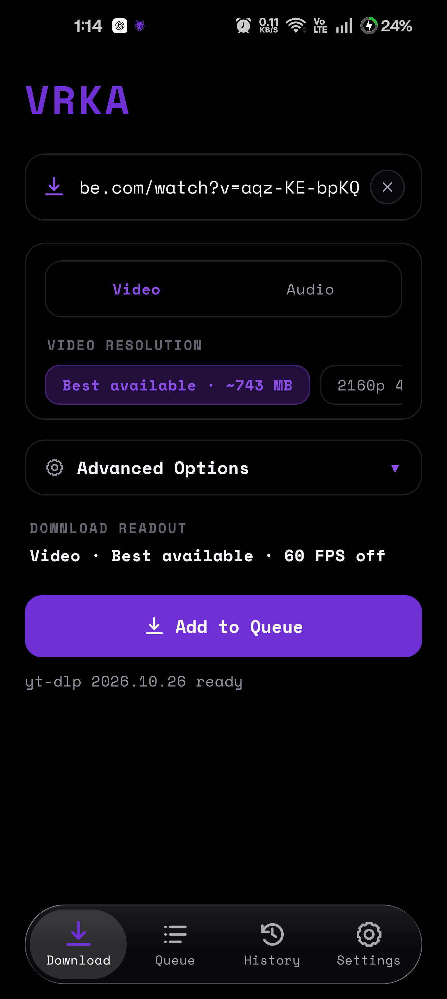
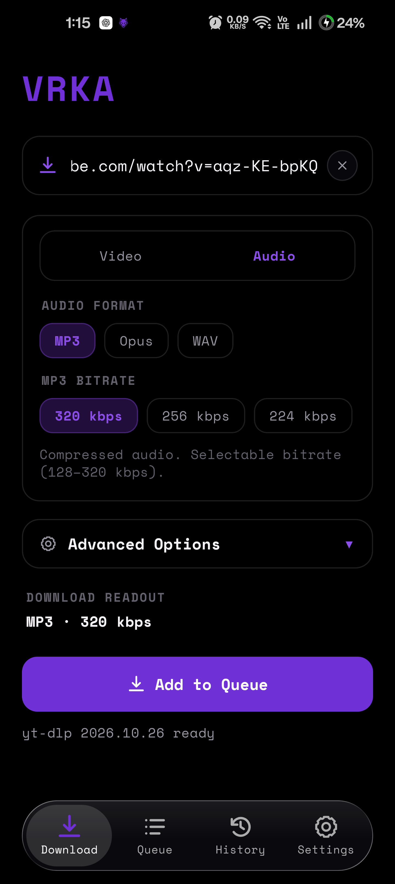
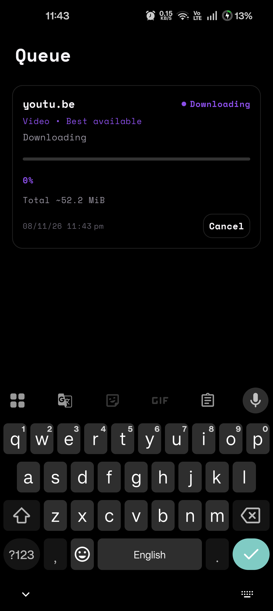
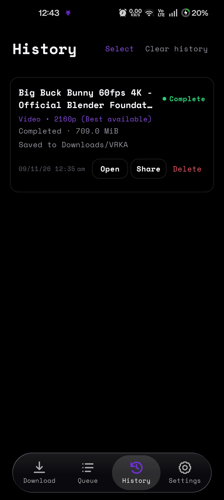
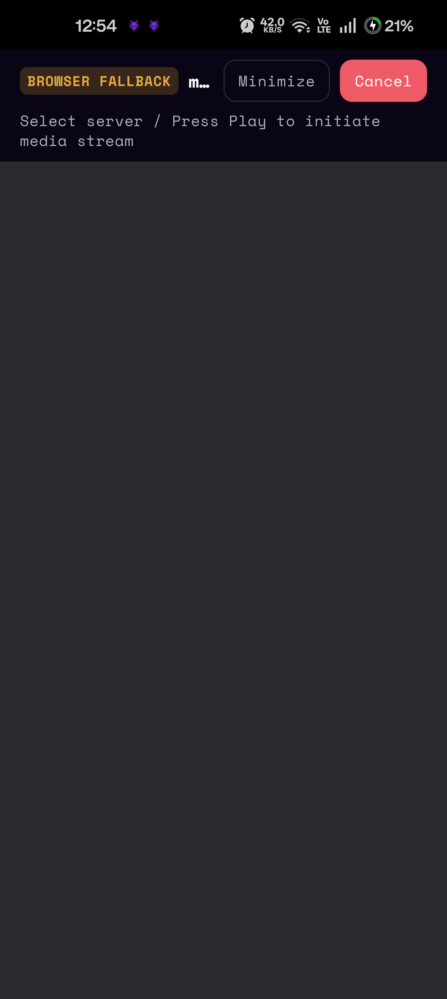
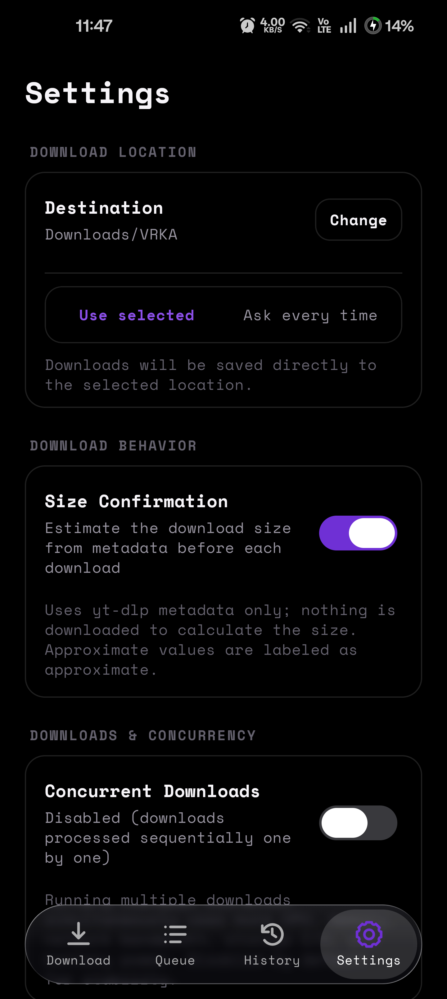
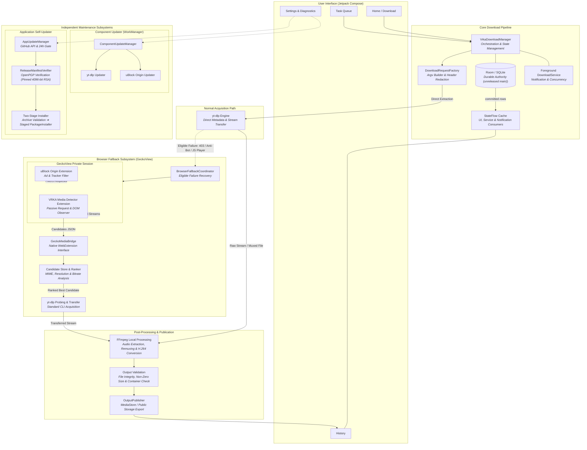

<div align="center">
  
  <h1>VRKA Android</h1>
  <p><strong>Native Android media downloader, passive web stream discovery, and 14-language localization.</strong></p>

  <p>
    <a href="https://github.com/MaverickRox/VRKA-Android/releases/latest"></a>
    <a href="LICENSE"></a>
    <a href="https://github.com/MaverickRox/VRKA-Android/releases"></a>
  </p>

  <p>
    <a href="https://github.com/MaverickRox/VRKA-Android/releases/latest"><b>Download APK (v5.1.2)</b></a> •
    <a href="#screenshots">Screenshots</a> •
    <a href="#features">Features</a> •
    <a href="#architecture">Architecture</a> •
    <a href="#build-instructions">Build Guide</a> •
    <a href="#release-signing">Signing Protocol</a> •
    <a href="SECURITY.md">Security</a>
  </p>
</div>

<br />

> [!IMPORTANT]
> **USERS UPGRADING FROM VRKA v5.0.2 MUST DOWNLOAD AND INSTALL v5.1.2 DIRECTLY FROM THE OFFICIAL GITHUB RELEASE PAGE. THE v5.0.2 IN-APP UPDATER CANNOT COMPLETE THIS UPDATE. DO NOT USE THE RETRY BUTTON.**
> 
> **OFFICIAL DOWNLOAD PAGE:**
> https://github.com/MaverickRox/VRKA-Android/releases/tag/v5.1.2
> 
> **INSTALLATION:** Download `VRKA-Android-v5.1.2.apk` from the Assets section and install it over your existing VRKA installation. NO NEED TO UNINSTALL v5.0.2 FIRST.

<div align="center">
  
</div>

---

## Origin

> [!NOTE]
> VRKA Android is the Android companion of the desktop media downloader [**VRKA**](https://github.com/MaverickRox/VRKA) by [MaverickRox](https://github.com/MaverickRox).
>
> - **Desktop Source Repository**: [https://github.com/MaverickRox/VRKA](https://github.com/MaverickRox/VRKA)
> - **Android Port Repository**: [https://github.com/MaverickRox/VRKA-Android](https://github.com/MaverickRox/VRKA-Android)

---

## Overview

**VRKA Android** is built with **Jetpack Compose** and **Kotlin Coroutines**. It is an open-source, on-device media downloader designed for Android with zero tracking or telemetry.

Core capabilities:
- **14-Language Localization**: Comprehensive multilingual interface across 14 languages plus System Default, with complete Right-to-Left (RTL) layout support for Arabic and 100% resource key parity.
- **Unified Media Pipeline**: Direct stream extraction and media downloads are executed through `yt-dlp`, with local container remuxing, audio extraction, and validation handled by `FFmpeg`.
- **Browser Fallback & Stream Discovery**: When direct extraction encounters anti-bot challenges or dynamic player scripts, an embedded Mozilla `GeckoView` private session activates. The internal first-party `VRKA Media Detector` WebExtension passively intercepts media streams, while bundled `uBlock Origin` filters ads and tracking scripts. Discovered candidates are handed back to `yt-dlp` for standard acquisition.
- **Cryptographic In-App Self-Updater**: Fully verified in-app updater querying official GitHub releases, validating machine-readable manifests against a pinned 4096-bit RSA OpenPGP release key (`0xD519380BEBA1B9F7`) with anti-freeze, anti-rollback, and two-stage staging checks.
- **AMOLED-Optimized Liquid Glass Design**: Hardware-accelerated backdrop blur, AGSL `RuntimeShader` lens refraction on API 33+, and an 18-track directional luminous wake download progress indicator.

---

## Screenshots

<div align="center">

<table>
  <tr>
    <td align="center" width="33%">
      <br />
      <b>Resolution Preflight</b><br />
      <sub>Synchronized 4K / 2K download size estimation</sub>
    </td>
    <td align="center" width="33%">
      <br />
      <b>Audio Extraction Mode</b><br />
      <sub>Direct YouTube audio with selectable MP3 bitrates</sub>
    </td>
    <td align="center" width="33%">
      <br />
      <b>Multi-Task Queue</b><br />
      <sub>Active transfer, live speed, ETA & queued jobs</sub>
    </td>
  </tr>
  <tr>
    <td align="center" width="33%">
      <br />
      <b>Download History</b><br />
      <sub>Multiple completed videos and audio with verified sizes</sub>
    </td>
    <td align="center" width="33%">
      <br />
      <b>Browser Fallback</b><br />
      <sub>Active stream playback & 11 streams captured</sub>
    </td>
    <td align="center" width="33%">
      <br />
      <b>Settings & Storage</b><br />
      <sub>Concurrency limits, typography & destination policies</sub>
    </td>
  </tr>
</table>
</div>

---

## Features

- **14-Language Interface Localization & RTL Support**: Complete interface localization across 14 languages plus System Default:
  - **Arabic** (`العربية` — full bidirectional Right-to-Left layout mirroring)
  - **Bengali** (`বাংলা`)
  - **Simplified Chinese** (`简体中文`)
  - **English** (`English` — default baseline)
  - **French** (`Français`)
  - **German** (`Deutsch`)
  - **Gujarati** (`ગુજરાતી`)
  - **Hindi** (`हिन्दी`)
  - **Kannada** (`ಕನ್ನಡ`)
  - **Portuguese (Brazil)** (`Português (Brasil)`)
  - **Portuguese (Portugal)** (`Português (Portugal)`)
  - **Spanish** (`Español`)
  - **Tamil** (`தமிழ்`)
  - **Telugu** (`తెలుగు`)
  - All 14 locales maintain 100% string resource key parity with verified format-string specifiers. Language selection is customizable in Settings and integrates with Android 13+ (API 33+) per-app language preferences.
- **Direct Extraction & Download**: Powered by `yt-dlp` and `FFmpeg` (`arm64-v8a`), supporting video and audio stream extraction, resolution selection (Best, 4K, 1440p, 1080p, 720p, 480p, 360p), 60 FPS preference, subtitle embedding, and audio extraction (MP3 with 128–320 kbps selectable bitrate, native Opus stream-copy remuxing with transcode fallback, and uncompressed 16-bit PCM WAV).
- **Resolution-Aware Download Size Estimation**: The metadata preflight uses the same yt-dlp format selector as the transfer, so the displayed size follows the selected resolution and only counts the selected video/audio streams. Browser Fallback estimates the selected candidate rather than the page, and unavailable metadata is reported honestly instead of fabricated. See [KNOWN_LIMITATIONS.md](KNOWN_LIMITATIONS.md).
- **Directional Luminous Wake Progress Bar**: Redesigned download progress renderer featuring an 18-track streak and cached analytic teardrop glow optimized for AMOLED displays.
- **Passive Browser Fallback**: When direct `yt-dlp` extraction encounters anti-bot challenges or dynamic player scripts, an embedded Mozilla `GeckoView` private session activates automatically.
- **First-Party Media Discovery**: Bundled internal `VRKA Media Detector` WebExtension (`media-detector@vrka.mvrk.com`) passively observes network requests and DOM media elements (`<video>`, `<audio>`, HLS `.m3u8`, DASH `.mpd`), passing candidates across `GeckoMediaBridge` to native Kotlin for candidate ranking and standard `yt-dlp` acquisition.
- **Integrated Content Filtering**: Bundled `uBlock Origin` (`uBlock0@raymondhill.net` v1.74.0) operates within GeckoView to suppress intrusive advertisements, tracking scripts, and popups during fallback observation.
- **yt-dlp Fallback Execution**: Candidate downloads are executed through standard `yt-dlp` requests. VRKA does not use an app-owned native HLS/DASH engine. Subtitle options apply to normal yt-dlp acquisitions.
- **Custom HTTP Headers & Injection Protection**: Network customization with dedicated `Referer` and `Origin` parameters and user-defined HTTP headers validated against RFC 7230 token specifications and CRLF injection rejection.
- **Sensitive Header Redaction**: Multi-tier data protection masking sensitive authorization tokens, cookies, and secret headers (`[REDACTED]`) across logs, crash diagnostics, on-device stores, and UI cards.
- **Dynamic Font Preference**: User-toggleable application typography supporting the signature monospace `VRKA Font` (Space Mono) and clean `System Font` (Roboto / device default) with persistent DataStore configuration.
- **Download Location Modes**: Clear destination control supporting "Use selected" (defaulting to Downloads/VRKA with persistent directory permissions) or "Ask every time" (modal confirmation before queuing).
- **Background Orchestration**: Foreground `DownloadService` with `JobStore` persistence, notification progress tracking, cancellation, and optional persisted parallel job execution (2–4 workers; sequential by default).
- **Local On-Device Diagnostics**: On-device failure logging with stage attribution, terminal trace viewer, and one-tap clipboard export. Source URLs are retained only for failed downloads; successful downloads do not add source URLs. Credentials and signed CDN query values are redacted, and export shows a warning with an explicit opt-in for the full original source URL.
- **H.264 Compatibility Mode**: Optional, off by default. If a downloaded video is not H.264, FFmpeg converts the local staged file, validates the result and preserves supported audio/subtitle streams.
- **Custom yt-dlp Commands**: Named argument templates for normal jobs. Templates are argv lists, not shell commands; VRKA controls output staging. Eligible failures can still enter Browser Fallback, whose standard yt-dlp request ignores the selected template.
- **Liquid Glass Design System**: Floating capsule navigation with hardware-accelerated `RenderEffect` backdrop blur across AMOLED Black and Light modes, with AGSL `RuntimeShader` lens refraction on API 33+.

### In-App Application Self-Update

VRKA Android includes a hardened, cryptographically verified in-app update engine querying official GitHub releases:

- **OpenPGP Authenticated Release Manifests**: Every release publishes a machine-readable manifest (`VRKA-Android-vX.Y.Z.manifest.json`) authenticated by a detached OpenPGP signature (`VRKA-Android-vX.Y.Z.manifest.json.asc`).
- **Pinned OpenPGP Trust Anchor**: Updates are cryptographically verified against the pinned official 4096-bit RSA release signing key (`0xD519380BEBA1B9F7`, fingerprint `71165A658B3A8612AC2568C6D519380BEBA1B9F7`) embedded within the application.
- **Anti-Rollback & Anti-Freeze Protections**: Monotonically non-decreasing metadata revision numbers prevent replay attacks, while mandatory expiration timestamps prevent freeze attacks.
- **24-Hour Automatic Gate**: Automatic startup checks run at most once every 24 hours to reduce network traffic.
- **Manual Check Bypass**: The `[Check for Updates]` button in Settings bypasses the 24-hour interval to check immediately.
- **Non-Blocking Startup**: Checks run asynchronously without slowing down app startup.
- **Canonical Stable Releases**: Accepts stable three-part tags such as `v5.1.2`, compares numeric version segments, and requires the exact matching asset `VRKA-Android-v5.1.2.apk`.
- **HTTPS-Only Networking & Host Validation**: Streams metadata and APK files over HTTPS from approved GitHub release hosts, rejecting user-info, nonstandard ports, and unapproved hosts.
- **Redirect Validation**: Validates every redirect target and limits redirect hops to at most 5.
- **Two-Stage Install Verification**: Verifies archive integrity, package identity, version code, and signer certificate on temporary downloads, followed by canonical filename verification on staged files before launching Android's `PackageInstaller`.
- **Persistent Downloads**: Downloads run through WorkManager so they survive process death or backgrounding.

### In-App Component Updates

VRKA Android independently manages and updates its core media and filtering components:

- **yt-dlp**: The installed runtime version is dynamically introspected from the active zipapp or bundled resources and updated using the app's updater. Custom runtimes can also be selected and validated in Settings.
- **uBlock Origin**: Bundled as a Firefox WebExtension XPI (`uBlock0@raymondhill.net` v1.74.0) in `assets/extensions/ublock.xpi`; it is installed and enabled for Browser Fallback sessions and updated independently.
- **Mozilla GeckoView Lifecycle**: GeckoView is a core compile-time Gradle dependency (`159.0.20261022150525`), not a dynamic downloadable component.
- **Retired Puemos Extension**: Completely removed. No assets shipped, not registered, and not updated.
- **Persistent Background Execution**: Component updates use WorkManager to survive Activity recreation and backgrounding.
- **Concurrency & Spam Protection**: Strict single-flight locking per component. Rapid taps are de-duplicated without freezing the UI.

---

## Architecture



### Architectural Highlights

1. **Durable Storage Authority (unreleased `main`)**: A single Room/SQLite database owns jobs, retry attempts, publication batches/outputs, cleanup obligations, and migration records. The existing `StateFlow` projection remains an in-memory cache refreshed only after committed transactions. Existing v5.1.0/v5.1.1/v5.1.2 JSON data is imported through a crash-safe, idempotent migration. The published v5.1.2 APK retains its JSON architecture; see [docs/STORAGE_ARCHITECTURE.md](docs/STORAGE_ARCHITECTURE.md) and [docs/STORAGE_MIGRATION.md](docs/STORAGE_MIGRATION.md).
2. **UI Layer & Localization**: Built with Jetpack Compose and design tokens (`VrkaTokens`), featuring floating capsule navigation with adaptive backdrop blur across AMOLED Dark and Light modes. Full 14-language internationalization with complete Right-to-Left (RTL) layout mirroring for Arabic and 100% key parity.
3. **Download Pipeline**: `VrkaDownloadManager` coordinates normal downloads using `DownloadRequestFactory` and `yt-dlp`. An eligible failure (such as anti-bot challenges or dynamic player scripts) triggers Browser Fallback.
4. **Browser Fallback Subsystem**: Mozilla GeckoView navigates in a task-scoped private session. The bundled first-party `VRKA Media Detector` WebExtension (`media-detector@vrka.mvrk.com`) and `GeckoMediaBridge` pass observed candidate streams to the native ranker. Bundled `uBlock Origin` filters intrusive advertisements and tracking requests. `yt-dlp` probes the selected candidate and performs the transfer via its standard request path.
5. **Local Processing & Validation**: `FFmpeg` handles local audio extraction, container remuxing, and optional H.264 transcoding. Completed files are validated for integrity before publication to the device storage via `OutputPublisher`.
6. **Component Updates vs Application Updates**: `yt-dlp` and `uBlock Origin` are independently updatable in the background via WorkManager. Mozilla GeckoView is a core Gradle dependency (`159.0.20261022150525`). Application updates are cryptographically authenticated using OpenPGP-signed manifests against the pinned release trust anchor (`0xD519380BEBA1B9F7`).
7. **Retired & Dormant Code Boundaries**: The legacy Puemos extension is completely retired and removed. Prototype transfer routing in `MediaEngineRouter` is dormant with no callers in the production download flow.

---

## Requirements

- **Device Architecture**: `arm64-v8a`
- **Minimum OS**: Android 8.0 (API Level 26)
- **Target OS**: Android 16 (API Level 36)
- **Compile SDK**: API 37, minor level 2
- **Java Development Kit**: JDK 17 or newer supported by the configured Gradle version (Android Studio JBR is suitable)
- **Android SDK**: Build-Tools 36.1+

---

## Build Instructions

### Prerequisites

Set `JAVA_HOME` to your JDK 17+ path:
```powershell
$env:JAVA_HOME = "C:\Program Files\Android\Android Studio\jbr"
```

### Running Offline Unit Tests

```powershell
.\gradlew.bat testDebugUnitTest --offline
```

### Running Provider Integration Tests

With an API 36 emulator running, execute the real MediaStore and SAF protocol suites:

```powershell
.\gradlew.bat --no-daemon connectedDebugAndroidTest '-Pandroid.testInstrumentationRunnerArguments.class=com.mvrk.vrka.SafPublicationIntegrationTest,com.mvrk.vrka.PublicationStorageIntegrationTest'
```

### Assembling Debug APK

```powershell
.\gradlew.bat assembleDebug --offline
```
Output artifact: `app/build/outputs/apk/debug/app-debug.apk`

### Assembling Release APK

Production release builds require explicit signing credentials. The build system **strictly rejects release builds without credentials** and will never silently fall back to debug signing.

1. Configure your release signing properties (outside Git) in `~/.vrka-android-signing/signing.properties` or via the `VRKA_SIGNING_PROPERTIES` environment variable:

```properties
storeFile=/absolute/path/to/vrka-release.p12
storePassword=YOUR_KEYSTORE_PASSWORD
keyAlias=YOUR_KEY_ALIAS
keyPassword=YOUR_KEY_PASSWORD
```

2. Build the release APK:

```powershell
$env:VRKA_SIGNING_PROPERTIES = "C:\Users\username\.vrka-android-signing\signing.properties"
.\gradlew.bat assembleRelease --offline
```

The compiled release artifact will be located at:
```
app/build/outputs/apk/release/app-release.apk
```

The official v5.1.2 release APK is production-signed. Check [RELEASE_EVIDENCE.md](RELEASE_EVIDENCE.md) for its exact path, SHA-256, package metadata and signing certificate.

---

## Release Signing

The `release` build type requires explicit signing credentials and never silently falls back to a debug key. Verify the v5.1.2 artifact's certificate and SHA-256 against [RELEASE_EVIDENCE.md](RELEASE_EVIDENCE.md) or official release checksums before installation.

---

## Installation

> [!NOTE]
> **Upgrading from v5.0.2**: Due to a known client-side verification check on temporary download files in the v5.0.2 binary, the in-app updater cannot self-execute the upgrade. Existing v5.0.2 users should download `VRKA-Android-v5.1.2.apk` directly and install it over v5.0.2. Because both versions share the identical production signing key, all app data, settings, and download histories are preserved.

1. Download the official `VRKA-Android-v5.1.2.apk` from [GitHub Releases](https://github.com/MaverickRox/VRKA-Android/releases/latest).
2. Verify the SHA-256 hash against `SHA256SUMS`:
   ```powershell
   (Get-FileHash .\VRKA-Android-v5.1.2.apk -Algorithm SHA256).Hash
   ```
   Expected: `3a28262db691858757afd9edbded1bedfcbbcef5d1eeeb56743a16d08eeafe9a`. The same value is recorded in `SHA256SUMS` and the official release page.
3. Install on your Android device:
   ```bash
   adb install -r .\VRKA-Android-v5.1.2.apk
   ```

---

## Third-Party Notices & Attribution

VRKA Android integrates and references the following open-source software and creative assets:
- **yt-dlp**: The Unlicense ([yt-dlp/yt-dlp](https://github.com/yt-dlp/yt-dlp))
- **Mozilla GeckoView**: Mozilla Public License 2.0 ([GeckoView](https://wiki.mozilla.org/Mobile/GeckoView))
- **uBlock Origin**: GNU General Public License v3.0 ([gorhill/uBlock](https://github.com/gorhill/uBlock))
- **FFmpeg**: LGPL / GPL licensed components ([FFmpeg](https://ffmpeg.org/))
- **Space Mono Font**: SIL Open Font License 1.1 ([Space Mono](https://github.com/googlefonts/spacemono))
- **Mornye Switch Component**: LGPL-3.0 / GPL-3.0 ([Mornye](https://github.com/MaverickRox/Mornye))
- **Big Buck Bunny**: © 2008, Blender Foundation / [www.bigbuckbunny.org](https://www.bigbuckbunny.org), licensed under Creative Commons Attribution 3.0 ([CC-BY 3.0](https://creativecommons.org/licenses/by/3.0/)).
- **Sintel**: © 2010, Blender Foundation / [durian.blender.org](https://durian.blender.org), licensed under Creative Commons Attribution 3.0 ([CC-BY 3.0](https://creativecommons.org/licenses/by/3.0/)).
- **Tears of Steel**: © 2012, Blender Foundation / [mango.blender.org](https://mango.blender.org), licensed under Creative Commons Attribution 3.0 ([CC-BY 3.0](https://creativecommons.org/licenses/by/3.0/)).
- **Shaka Player Demo**: Google LLC, licensed under Apache License 2.0 ([Shaka Player](https://github.com/shaka-project/shaka-player)).

---

## License

VRKA Android is free software licensed under the [GNU General Public License v3.0](LICENSE).
See the [LICENSE](LICENSE) file for details.
